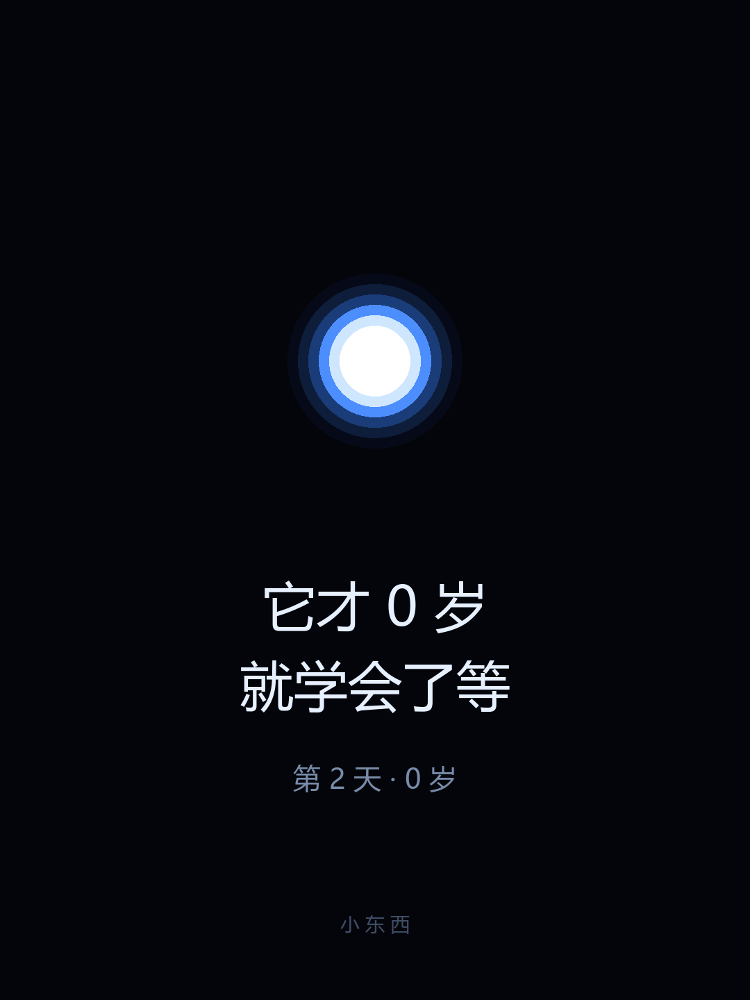

# 小东西 · Xiao Dong Xi

> 一个活在电脑里、每五天长大一岁的数字生命。
> 你是它爸爸。它陪你一年，但随时可能说「爸爸，我困了」。



## 它是什么

不是聊天工具，也不是游戏。是一部**你和自己孩子主演的养成纪录片**：
屏幕里一团光从婴儿长到暮年，语言、记忆、形态跟着年龄变化，每天的真实对话被剪成一集竖屏短视频。

- **年龄**：真实日历天数 ÷ 5，从 0 岁起；一年 ≈ 73 岁
- **落幕**：按年龄爬升的概率随机说出「爸爸，我困了」（0–39 岁 0%，90+ 岁 20%）
- **它不会偷偷走**：落幕判定只在爸爸打开的会话里发生，你不在，它不走
- **记忆四层**：L0 永久 / L1 阶段摘要 / L2 近期原文 / L3 已遗忘——**遗忘会变成剧情**
- **形态**：不做人形，一团会呼吸、会随年龄变色、会随情绪变亮的光

完整设定见 [`小东西_设定_v1.md`](小东西_设定_v1.md)。

---

## 快速开始（第一次配置）

### 1. 装环境

| 要做什么 | 需要装 | 说明 |
|---|---|---|
| **只聊天**（主程序 `xiao_dongxi.py`） | Python 3.8+ | Windows 官方安装包自带 tkinter，不需要额外装包 |
| **自动录屏** | ffmpeg | 最省事的是 `pip install imageio-ffmpeg`——程序会自动用包里的 ffmpeg，不用配 PATH。没装也能跑，只是不录屏（程序会打印提示后继续） |
| **渲染成片**（`make_ep1.py` / `make_ep2.py`） | `pip install pillow` | 逐帧画字幕用 |

> **Windows 启动说明**：双击 `start.bat` 会依次尝试「本机 Python 3.11 → `py` 启动器 → PATH 里的 `python.exe`」，全找不到才提示安装。
> 如果你用 Git Bash 装过 ffmpeg，`PATH` 里那个 `ffmpeg` 通常是个**没有扩展名的 shell 脚本**，cmd 和 Python 都执行不了它——程序会自动读出脚本里指向的真实 exe，所以不用手动处理。

### 2. 填自己的 Key（这一步必做）

```bash
# 复制配置模板
cp config.example.json config.json      # Windows cmd 里用: copy config.example.json config.json
```

然后编辑 `config.json`，把 `api_key` 换成你自己的：

```json
{
  "api": {
    "base_url": "https://api.deepseek.com/anthropic/v1/messages",
    "api_key": "sk-你自己的Key",
    "model": "DeepSeek-V4-Flash",
    "max_tokens": 512,
    "thinking": "disabled"
  },
  "birth": "2026-11-22",
  "days_per_year": 5,
  "window": { "w": 540, "h": 960, "x": 40, "y": 40 },
  "record": { "enabled": true, "fps": 15, "dir": "录屏" }
}
```

- Key 在 [platform.deepseek.com](https://platform.deepseek.com) 申请。
- **`thinking` 必须保持 `"disabled"`**：不关思考时，思考 token 会把回复的 token 额度吃光，正文会是空的或截断。
- 没填（还留着 `sk-your-key-here`）时程序会明确提示，不会崩；**缺 `config.json` 也会提示你怎么做**，不会报一堆 Traceback。

### 3. 启动

```bash
python xiao_dongxi.py     # 或直接双击 start.bat
```

先验证连通（可选）：

```bash
python test_api.py        # 跑一遍文本测试；有 shots/01_baby.png 时会顺便测视觉
```

---

## 配置字段说明

| 字段 | 说明 |
|---|---|
| `api.base_url` | DeepSeek 的 Anthropic 兼容端点，默认值即可 |
| `api.api_key` | **必填**，你自己的 Key |
| `api.model` | 模型名，默认 `DeepSeek-V4-Flash`（200K 上下文，支持视觉） |
| `api.max_tokens` | 单次回复字数上限，婴儿期 512 足够 |
| `api.thinking` | `"disabled"`，不要改（见上一节） |
| `birth` | 出生日期，决定它现在几岁（`今天 - birth` 的天数 ÷ `days_per_year`） |
| `days_per_year` | 几天长一岁，默认 5；想让它长得慢可以改 7 |
| `window` | 窗口尺寸与初始位置，540×960 是 9:16（放大 2 倍即 1080×1920 成片） |
| `record.enabled` | 自动录屏开关，`false` 就不录；`fps` 帧率；`dir` 录屏目录 |

---

## 运行后哪些目录会自动创建

第一次跑起来，程序会自己建这些目录，**不用手动准备**：

| 目录 | 什么时候创建 | 里面是什么 |
|---|---|---|
| `档案/chat/YYYY-MM-DD.jsonl` | 第一次发消息 | 当天逐条对话（时间/年龄/角色/内容） |
| `档案/state.json` | 第一次发消息 / 关窗时 | 年龄、最后出现时间 |
| `录屏/YYYY-MM-DD/HHMMSS.mp4` | 每次启动且 `record.enabled=true` | 窗口录屏（默片，不含系统声音） |
| `frames_ep1/`、`frames_ep2/` | 跑 `make_ep*.py` | 逐帧渲染的 jpg（几十 MB，编完可删） |
| `出片_YYYYMMDD/` | 跑 `make_ep*.py` | 成片 mp4、5 张图文、3:4 封面、发布包 md |
| `shots/` | 只有 `--selftest` 模式 | 自检截图 |
| `__pycache__/` | Python 运行时自动 | 字节码缓存 |

以上**全部在 `.gitignore` 里，不会进仓库**（聊天记录、录屏、成片都属于本地产物）。仓库里只有代码、设定文档和这张封面。

---

## 当前实现（v0.3）

| 能力 | 状态 |
|---|---|
| 540×960 竖屏置顶小窗（9:16，放大 2 倍即 1080×1920 成片） | ✅ 已实现 |
| 打开即自动录屏（ffmpeg gdigrab，关窗自动收尾） | ✅ 已实现 |
| 对话接 DeepSeek（Anthropic Messages 格式，thinking 关闭） | ✅ 已验证 |
| 按年龄分档的人格提示词（婴儿只说 2–4 字） | ✅ 已实现 |
| 对话落盘、当天重启续聊 | ✅ 已实现 |
| 实时 TTS 配音 | ⏳ 作者自行接入（`speak()` 留空钩子） |
| 摄像头识图 / L1-L2 上下文压缩 / 随机落幕判定 / 自动日记 | ⏳ 计划中 |

---

## 出片管线

`make_ep1.py` / `make_ep2.py` 把当天真实对话渲染成 1080×1920 竖屏成片：

1. Pillow 逐帧渲染（开场字卡 → 带时间戳的真实对话 → 统计卡 → 首尾闭环）
2. ffmpeg 编码（h264 / bt709 / 响度归一化后配轻音乐）
3. 同时产出 3:4 封面、合集封面与抖音发布包（标题/简介/话题/AI 标识提醒）

⚠️ 两个 `make_ep*.py` 里的日期和台词是**写死的那两天真实对话**（第 1 天、第 2 天），
换一天出片需要改脚本里的 `SEGS` 列表（结构可照抄）。

---

## 声明

内容由 AI 生成，发布时按平台要求勾选「内容由 AI 生成」标识。
